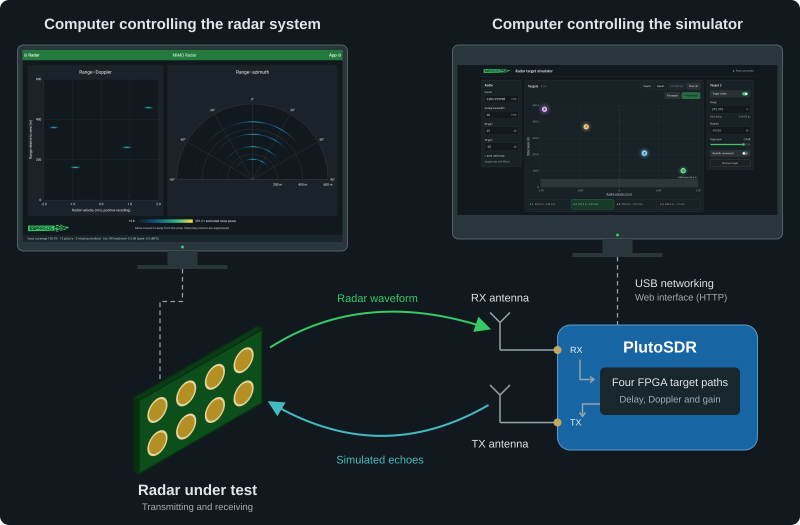
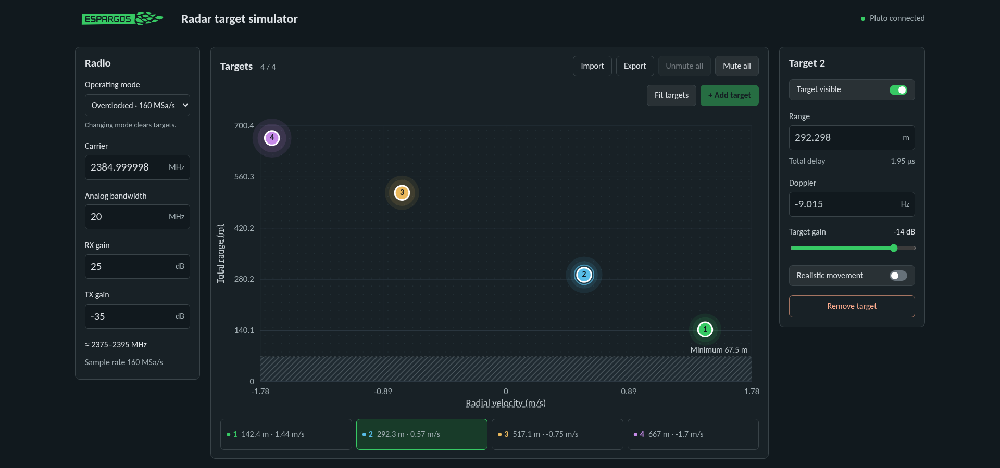
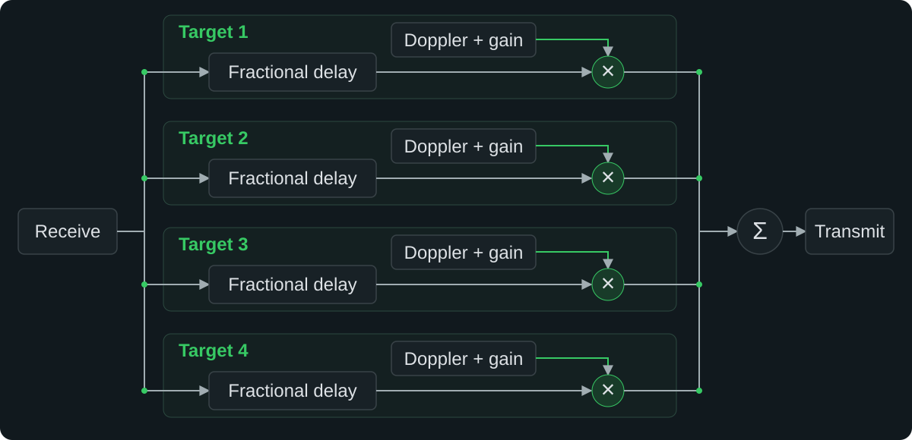

# PlutoSDR radar target simulator

Radar target simulators are devices for testing radar hardware and signal processing algorithms
without requiring large-scale trial runs. But since these devices are so specialized, they tend
to be quite expensive.

This firmware turns a low-cost PlutoSDR into a radar target simulator. The PlutoSDR receives a signal,
creates up to four echoes with different delays and Doppler shifts via real-time FPGA processing,
and transmits them back.



A web interface hosted on the Pluto lets you place targets and adjust their strength:



You can drag targets in range and velocity, enter exact settings in the sidebar,
or save a scene to use again later. Changes take effect as you drag. The interface
also controls the carrier frequency, analog bandwidth and RX/TX gains.

## Connections

The radar sends a waveform to Pluto's RX antenna. Pluto adds the configured
echoes in its FPGA and sends them back through its TX antenna. One computer runs
the radar software and another opens Pluto's web interface. Both can be the same
machine.

## Installation instructions

Install the ready-made firmware, then control the simulator from your browser.
No build tools are needed. The firmware includes the simulator and its web
interface for Rev.B and Rev.C PlutoSDR hardware. Check the release notes for
compatibility with your device.

1. Download **`pluto.frm`** from this project's **Releases** section on GitHub.
   If it is supplied in a ZIP archive, extract it first.
2. Connect Pluto to your computer through its USB data port. A drive named
   **PlutoSDR** should appear in your file manager.
3. Drag **`pluto.frm`** onto that drive and wait for the copy to finish.
4. **Eject the PlutoSDR drive in your file manager, leaving the USB cable connected.**
   Ejecting starts the update. The blue LED flashes rapidly while it installs.
   Keep Pluto powered until the update finishes and the drive reappears.
5. Open **http://192.168.2.1/** in your browser. If you previously changed Pluto's
   USB IP address, use that address instead. The status at the top right shows
   startup progress. Once it is ready, you can add targets.

Installation replaces Pluto's current application firmware. For backups or help
recovering a device, see the [installation and recovery guide](docs/firmware.md).
The drag-and-drop procedure is also described in
[Analog Devices' firmware update guide](https://analogdevicesinc.github.io/system-level/solutions/platforms/pluto/get-started/firmware/).

## Technical specifications

You can simulate **up to four targets**, each with its own distance, radial
velocity and echo strength. Delaying an echo makes the target appear farther
away. Shifting its frequency makes it appear to move toward or away from the radar.
The optional movement setting changes its distance over time to match that velocity.

Pluto takes a small amount of time to receive and retransmit a signal, even when
no extra delay is selected. With the default 20 MHz bandwidth, this corresponds
to about **67.5 m** in overclocked mode or **163.5 m** in standard mode. The web
interface includes this delay in the displayed distance and shades the
unreachable region.

The analog bandwidth is configurable and defaults to **20 MHz**. Wider settings
require the tuning range extension described below. The internal sample rate
is higher to reduce delay, and does not describe the reflected RF bandwidth.

| Feature | Standard mode | Overclocked mode |
| --- | --- | --- |
| Analog bandwidth, common RX/TX setting | 0.2–30.72 MHz | 0.2–56 MHz |
| Carrier frequency | 325–3800 MHz, extended to 70 MHz–6 GHz as described below | Same |
| Hardware | PlutoSDR Rev.B and Rev.C/D | Same |
| Targets | Up to 4 independent distances, velocities and echo strengths | Same |
| Maximum simulated distance | About 30.1 km | About 11.6 km |
| Minimum distance, 20 MHz bandwidth | 163.5 m (1.091 µs) | 67.5 m (0.450 µs) |
| Minimum distance, widest bandwidth | 160.9 m (1.073 µs) | 62.1 m (0.414 µs) |
| Fractional-delay distance step | About 2.38 mm | About 0.915 mm |
| Doppler step | About 0.014 Hz | About 0.037 Hz |
| Target gain | −90 to 0 dB per echo | Same |
| Moving targets | Fractional delay and carrier phase updated on every FPGA sample | Same |
| Internal sample rate | 61.44 MSa/s | 160 MSa/s |

Delays in parentheses are the reference receive-to-transmit delays. Distance
adjustment steps describe the available settings, not absolute range accuracy.
The UI converts Doppler to radial velocity at the selected carrier.

### Tuning range extension

Pluto's AD9363 is specified for 325–3800 MHz and 20 MHz bandwidth. The
[ADI tuning range extension](https://analogdevicesinc.github.io/system-level/tools/pluto/users/customizing/)
configures its driver as an AD9364, enabling 70 MHz–6 GHz tuning and wider
filters without a hardware modification. Performance outside the AD9363's
specifications is not guaranteed.

Connect with `ssh root@192.168.2.1` (factory password `analog`), then run on Pluto:

```sh
fw_setenv attr_name compatible
fw_setenv attr_val ad9364
fw_setenv compatible ad9364
reboot
```

The setting persists across reboots. The web interface detects the extended
limits automatically.

### Overclocked operation and automatic fallback

The shorter minimum distance comes from running Pluto's radio interface at
**160 MHz**, above its specified **61.44 MHz** limit. Operation at this rate
depends on the individual device. The limit comes from the
[AD9363 datasheet, pages 6–7](https://www.analog.com/media/en/technical-documentation/data-sheets/AD9363.pdf).

Select **Standard** or **Overclocked** in the radio panel. Changing modes restarts
the radio, clears the scene and resets bandwidth to 20 MHz. The selection is
saved across reboots.

At startup, the simulator checks whether the selected mode works. If the
overclocked setting fails or times out, it tries standard mode instead. The web
interface reports the fallback and adjusts the shaded region automatically.
If neither setting passes, transmission stays muted.

The displayed minimum distances are reference values, not individual calibration
of your Pluto. For bandwidth settings without a delay reference, the interface
shows added range instead. See [operating limits](docs/limitations.md) for details
about range, antenna coupling and moving targets.

## Related work

Sumin Han and colleagues describe a similar approach that receives and
retransmits radar signals in
[“Application of Low-Cost Pluto SDR as a Radar Target Simulator”](https://doi.org/10.5515/KJKIEES.2026.37.1.117)
(*J. Korean Inst. Electromagn. Eng. Sci.*, 37(1), 117–120, 2026).
Their paper reports simulated distances up to 300 km in 5 m steps. This project
focuses on four independently adjustable targets, fractional delay, continuous
FPGA motion and a browser interface, with source code and ready-made firmware.
The paper does not link to a source repository or report the receive-to-transmit
delay, so we cannot compare the closest distance each simulator can represent.

## Using the radar target simulator

With the radar firmware installed, open **http://192.168.2.1/** (or your Pluto's
USB address). The status at the top right shows radio setup and startup checks.

1. Set the carrier and bandwidth to match your radar. Changing the carrier mutes
   all targets.
2. Adjust RX and TX gains if needed. The defaults are RX 25 dB and TX −35 dB.
3. Click **+ Add target**, then drag the point or edit its settings. New targets
   are enabled automatically with −14 dB target gain.
4. Scroll over an underlined axis label to zoom that axis. The label highlights
   on hover. Scrolling elsewhere on the plot does not zoom.
   Click the label to open a zoom slider. On a touchscreen, spread your fingers
   horizontally to zoom velocity or vertically to zoom range. Both axes respond
   independently when you pinch diagonally.
   **Fit targets** brings all targets into view.
5. Turn on **Realistic movement** to advance a target at its radial velocity.
   It bounces between the minimum reachable range and the top of the range axis.
   Movement runs on the FPGA, even after you close the browser.
6. Use **Target visible** for an individual target, **Mute all** to silence them all,
   or **Unmute all** to make every configured target visible.

Edits take effect immediately, so there is no Apply button. Use **Export** to save
a scene and **Import** to load it later. The simulator starts with no active targets
after a reboot. Setting RX gain switches the receiver to manual gain control.
Each target also has its own echo strength, controlled by **Target gain**.
This is separate from the radio's RX and TX gains, which affect all targets.
Its colored halo grows as you increase the gain.

To try the interface without hardware, you only need Python 3.10 or later:

```sh
make web
# Open http://127.0.0.1:8080/
```

## ESPARGOS One and measurement reproduction

<p align="center"><a href="https://espargos.net/espargos-one/"></a></p>

You can use ESPARGOS One as the radar with the [pyespargos MIMO radar demo](espargos-experiments/demo.md).
The [espargos-experiments](espargos-experiments/README.md) folder contains setup
instructions, acquisition recipes and analysis scripts to reproduce the paper’s
measurements and plots. These tools are optional. The simulator works independently
of ESPARGOS.

## How it works

Each path delays the incoming samples using an integer delay and a fractional-delay
filter, applies a Doppler shift and scales their amplitude. The four echoes are then added together and sent to the transmitter.



The [architecture guide](docs/architecture.md) describes the arithmetic,
configuration interface and scene format.

## Building the firmware

You will need Vivado/Vitis 2023.2 and Docker. The build uses a fixed ADI HDL
revision and a pinned development container. You will need to provide your own
AMD tool installation.
See [the build guide](docs/build.md) for setup.

```sh
make test       # run the HDL and control tests
make fpga       # build the FPGA bitstream
make tools      # build the ARM control programs
make firmware   # assemble the firmware image
make release    # collect GitHub release files in release/
```

The result is `build/firmware/pluto.frm`, containing the FPGA, Linux system and
web interface. Packaging uses the kernel and root filesystem from a compatible
Pluto firmware image that you provide. Follow the
[installation and recovery guide](docs/firmware.md) to back up your device,
prepare that image and flash the result.

Build outputs, firmware backups and raw captures stay in `build/` and are excluded
from Git.

## Documentation

- [Build setup](docs/build.md)
- [Installation, backups and recovery](docs/firmware.md)
- [Signal processing and HTTP API](docs/architecture.md)
- [FPGA registers](docs/registers.md)
- [Operating limits](docs/limitations.md)
- [Running tests](docs/testing.md)
- [Contributing](CONTRIBUTING.md)
- [Third-party licenses](THIRD_PARTY.md)

## Source layout

| Directory | Contents |
| --- | --- |
| `rtl/` | Target processing, AXI registers and clock-domain constraints |
| `patches/` | Changes to the ADI HDL |
| `host/` | Pluto control programs, startup script and preview server |
| `web/` | Web interface and its assets |
| `scripts/` | Build tools and deployment scripts |
| `tests/` | HDL, control and browser tests |
| `config/` | Example scenes |
| `docs/` | User and developer guides, diagrams |
| `espargos-experiments/` | Optional ESPARGOS acquisition, analysis and paper figures |

## AI use

All source code written for this project was AI-generated. Third-party code
keeps its original authorship and licenses.

## License

The project code, documentation and included ESPARGOS assets are licensed under
**GNU GPL version 3** (`GPL-3.0-only`), as described in [LICENSE](LICENSE). Fonts, upstream HDL
and firmware components keep their own licenses, listed in
[THIRD_PARTY.md](THIRD_PARTY.md).
