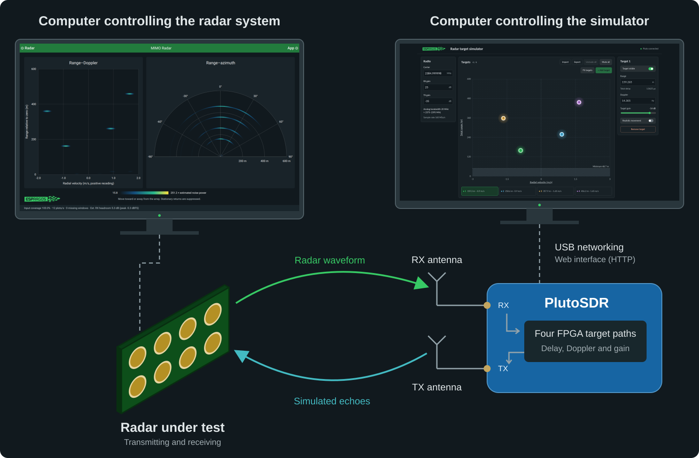
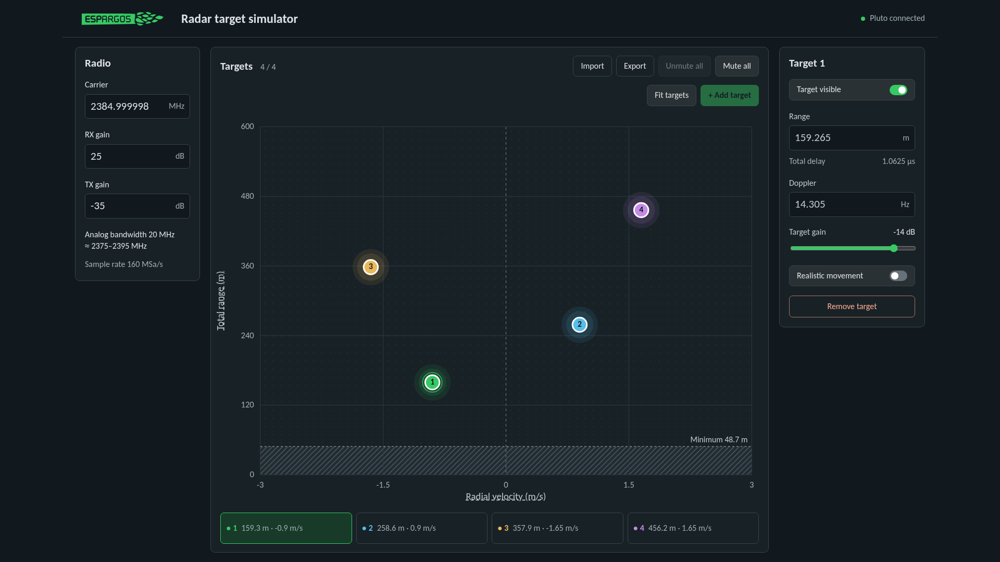
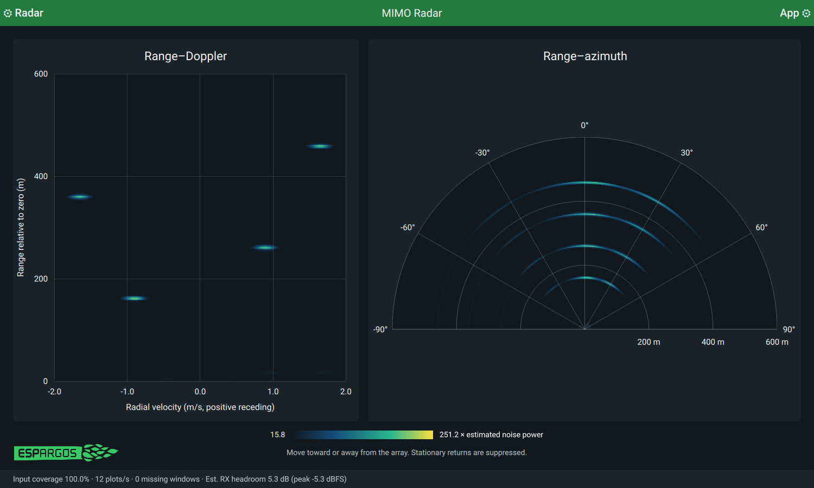
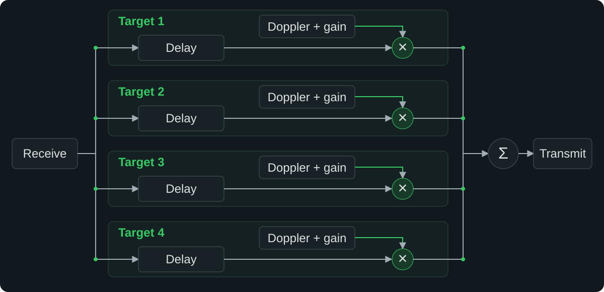

# PlutoSDR radar target simulator

This project turns a PlutoSDR into a radar target simulator. It receives a signal,
creates up to four echoes with different delays and Doppler shifts, and transmits
them back. The FPGA processes the signal.



A web interface hosted on the Pluto lets you place targets and adjust their strength:



You can drag targets in range and velocity, enter exact settings in the sidebar,
or save a scene to use again later. Changes take effect as you drag. The interface
also controls the carrier frequency and RX/TX gains.

## Test setup

The radar sends a waveform to Pluto's RX antenna. Pluto adds the configured
echoes in its FPGA and sends them back through its TX antenna. One computer runs
the radar software and another opens Pluto's web interface. Both can be the same
machine.

## Installation instructions

Install the ready-made firmware, then control the simulator from your browser.
No build tools are needed. The firmware includes the simulator and its web
interface and has been tested on Rev.B and Rev.C PlutoSDR hardware. Check the release
notes for compatibility with your device.

1. Download **`pluto.frm`** from this project's **Releases** section on GitHub.
   If it is supplied in a ZIP archive, extract it first.
2. Connect Pluto to your computer through its USB data port. A drive named
   **PlutoSDR** should appear in your file manager.
3. Drag **`pluto.frm`** onto that drive and wait for the copy to finish.
4. **Eject the PlutoSDR drive in your file manager, leaving the USB cable connected.**
   Ejecting starts the update. The blue LED flashes rapidly while it installs.
   Keep Pluto powered until the update finishes and the drive reappears.
5. Open **http://192.168.2.1/** in your browser. If you previously changed Pluto's
   USB IP address, use that address instead. The status at the top right shows
   startup progress. Once it is ready, you can add targets.

Installation replaces Pluto's current application firmware. For backups or help
recovering a device, see the [installation and recovery guide](docs/firmware.md).
The drag-and-drop procedure is also described in
[Analog Devices' firmware update guide](https://analogdevicesinc.github.io/system-level/solutions/platforms/pluto/get-started/firmware/).

## Technical specifications

You can simulate **up to four targets**, each with its own distance, radial
velocity and echo strength. Delaying an echo makes the target appear farther
away. Shifting its frequency makes it appear to move toward or away from the radar.
The optional movement setting changes its distance over time to match that velocity.

Pluto takes a small amount of time to receive and retransmit a signal, even when
no extra delay is selected. We measured **0.325 µs**, which looks like a target
about **48.7 m** away to a radar that measures distance from the echo's round-trip
time. This is the closest target the simulator can represent in its faster mode.
The web interface includes this delay in the displayed distance and shades the
unreachable region.

The simulator passes a **20 MHz band around the selected carrier frequency**.
For example, at 2385 MHz this is roughly 2375–2395 MHz, with gradual roll-off at
the edges. Its internal sample rate is higher to reduce delay. That does not mean
it can reflect a 160 MHz-wide radar signal.

| Feature | Capability |
| --- | --- |
| Analog bandwidth | 20 MHz |
| Carrier frequency | 325–3800 MHz in the simulator. Pluto’s frequency-range hack can unlock 70–6000 MHz at the driver level (see below). |
| Hardware | PlutoSDR, tested on Rev.B and Rev.C |
| Targets | Up to 4, with independent distance, velocity and echo strength |
| Simulated distance | About 48.7 m to 1.97 km, or 117.1 m to 5.11 km in fallback mode |
| Distance adjustment | 0.94 m steps, or 2.44 m in fallback mode |
| Doppler adjustment | About 0.037 Hz steps, or 0.014 Hz in fallback mode. The UI converts these to radial velocity at the selected carrier. |
| Target gain | −90 to 0 dB, applied separately to each echo |
| Moving targets | Distance updated 100 times per second, in the distance steps above |
| Receive-to-transmit delay | Measured at 0.325 µs, or 0.781 µs in fallback mode |
| Internal sample rate | 160 MSa/s, or 61.44 MSa/s in fallback mode |

Pluto’s [frequency-range hack](https://analogdevicesinc.github.io/system-level/tools/pluto/users/customizing/)
configures its driver to treat the radio as an AD9364 or AD9361, allowing tuning
from 70 MHz to 6 GHz. The simulator’s current UI and API still enforce
325–3800 MHz, so changing that driver setting alone does not extend the range
available here. Performance outside Pluto’s specified band is not guaranteed.

### Faster operation and automatic fallback

The shorter minimum distance comes from running Pluto's radio interface at
**160 MHz**, above its specified **61.44 MHz** limit. It worked on the Rev.B and Rev.C units
we tested, but a successful test does not guarantee reliable overclocked operation
on every device. The limit comes from the
[AD9363 datasheet, pages 6–7](https://www.analog.com/media/en/technical-documentation/data-sheets/AD9363.pdf).

At startup, the simulator checks whether the faster setting works. If that check
fails or times out, it tries 61.44 MHz instead. This keeps the same four targets
and 20 MHz bandwidth, but increases the minimum distance to **117.1 m**. The web
interface reports the fallback and adjusts the shaded region automatically.
If neither setting passes, transmission stays muted. Each reboot tries the faster
setting again.

The displayed minimum distances use our measurements as reference values. They
are not an individual calibration of your Pluto. See the
[measurement notes](docs/validation.md) for signal-quality results and the
[clock comparison](docs/validation/clock-compromise.md) for timing measurements.

## Related work

Sumin Han and colleagues describe a similar approach that receives and
retransmits radar signals in
[“Application of Low-Cost Pluto SDR as a Radar Target Simulator”](https://doi.org/10.5515/KJKIEES.2026.37.1.117)
(*J. Korean Inst. Electromagn. Eng. Sci.*, 37(1), 117–120, 2026).
Their paper reports simulated distances up to 300 km in 5 m steps. This project
focuses on shorter distances, with four independently adjustable targets, finer
0.94 m distance steps and a browser interface. Its faster mode reaches about
1.97 km. The paper does not report the receive-to-transmit delay, so we cannot
compare the closest distance each simulator can represent.

## Using the radar target simulator

With the radar firmware installed, open **http://192.168.2.1/** (or your Pluto's
USB address). The status at the top right shows startup progress. Radio setup
and checks usually take about 30 seconds after Pluto boots.

1. Set the carrier to match your radar. Changing it mutes all targets.
2. Adjust RX and TX gains if needed. The defaults are RX 25 dB and TX −35 dB.
3. Click **+ Add target**, then drag the point or edit its settings. New targets
   are enabled automatically with −14 dB target gain.
4. Scroll over an underlined axis label to zoom that axis. The label highlights
   on hover. Scrolling elsewhere on the plot does not zoom.
   Click the label to open a zoom slider. On a touchscreen, spread your fingers
   horizontally to zoom velocity or vertically to zoom range. Both axes respond
   independently when you pinch diagonally.
   **Fit targets** brings all targets into view.
5. Turn on **Realistic movement** to advance a target at its radial velocity.
   It bounces between the minimum reachable range and the top of the range axis.
   Movement runs on Pluto, even after you close the browser.
6. Use **Target visible** for an individual target, **Mute all** to silence them all,
   or **Unmute all** to make every configured target visible.

Edits take effect immediately, so there is no Apply button. Use **Export** to save
a scene and **Import** to load it later. The simulator starts with no active targets
after a reboot. Setting RX gain switches the receiver to manual gain control.
Each target also has its own echo strength, controlled by **Target gain**.
This is separate from the radio's RX and TX gains, which affect all targets.
Its colored halo grows as you increase the gain.

To try the interface without hardware, you only need Python 3.10 or later:

```sh
make web
# Open http://127.0.0.1:8080/
```

## Using the ESPARGOS MIMO radar demo

You can use the simulator with the MIMO radar demo in `pyespargos` to see the
four echoes on a range–velocity plot. Run the following from the `pyespargos`
directory, replacing `172.16.0.241` with your ESPARGOS address:

```sh
./demos/iq/mimo-radar/main.py -s 172.16.0.241 \
  -o app.sample_rate=20 -o app.range_maximum=600
```

This selects a 20 MSa/s radar sample rate and a 600 m display range. Set both
the demo and Pluto to the same carrier frequency. Both default to 2385 MHz.
Add targets in the Pluto web interface, then adjust the demo's velocity window
to include them. The simulator starts with a 600 m range and ±3 m/s window.

Use the default gains as a starting point and adjust them for your antenna
placement. A stationary target may disappear because the demo suppresses
stationary reflections. Give it a nonzero velocity to make it visible. See the
[example measurements](docs/validation/startup-and-defaults.md) for a working setup.



## How it works

Each path delays the incoming samples, applies a Doppler shift and scales their
amplitude. The four echoes are then added together and sent to the transmitter.



The [architecture guide](docs/architecture.md) describes the arithmetic,
configuration interface and scene format.

## Building the firmware

You will need Vivado/Vitis 2023.2 and Docker. The build uses a fixed ADI HDL
revision and a pinned development container. You will need to provide your own
AMD tool installation.
See [the build guide](docs/build.md) for setup.

```sh
make test       # run the HDL and control tests
make fpga       # build the FPGA bitstream
make tools      # build the ARM control programs
make firmware   # assemble the firmware image
```

The result is `build/firmware/pluto.frm`, containing the FPGA, Linux system and
web interface. Packaging uses the kernel and root filesystem from a compatible
Pluto firmware image that you provide. Follow the
[installation and recovery guide](docs/firmware.md) to back up your device,
prepare that image and flash the result. Other base firmware versions and Pluto
revisions still need testing.

Build outputs, firmware backups and raw captures stay in `build/` and are excluded
from Git.

## Preparing a GitHub release

Run `make release` after building the FPGA and preparing the base firmware.
The gitignored `release/` folder contains the four files to upload: `pluto.frm`,
`firmware-manifest.json`, `radar-target-simulator-source.tar.gz` and `SHA256SUMS`.
See the [release instructions](docs/build.md#preparing-a-release) for details.

## Documentation

- [Build setup](docs/build.md)
- [Installation, backups and recovery](docs/firmware.md)
- [Signal processing and HTTP API](docs/architecture.md)
- [FPGA registers](docs/registers.md)
- [Measurements and limitations](docs/validation.md)
- [Running tests and ESPARGOS measurements](docs/testing.md)
- [Contributing](CONTRIBUTING.md)
- [Third-party licenses](THIRD_PARTY.md)

## Source layout

| Directory | Contents |
| --- | --- |
| `rtl/` | Target processing, AXI registers and clock-domain constraints |
| `patches/` | Changes to the ADI HDL |
| `host/` | Pluto control programs, startup script and preview server |
| `web/` | Web interface and its assets |
| `scripts/` | Build tools, deployment scripts and measurement utilities |
| `tests/` | Simulation, analysis and browser tests |
| `config/` | Example scenes and lab settings |
| `docs/` | Guides, diagrams and measurement results |

## AI use

All source code written for this project was AI-generated. Third-party code
retains its original authorship and licenses.

## License

The project code, documentation and included ESPARGOS assets are licensed under
**GNU GPL version 3** (`GPL-3.0-only`), as described in [LICENSE](LICENSE). Fonts, upstream HDL
and firmware components keep their own licenses, listed in
[THIRD_PARTY.md](THIRD_PARTY.md).
