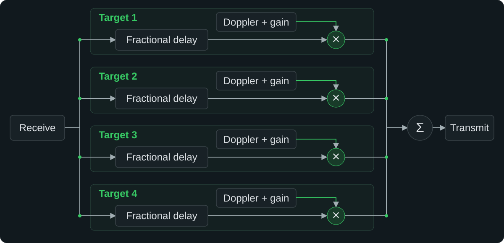

# Signal processing and controls

The FPGA creates four echoes from the incoming complex samples. Each path has
a 12288-sample history, a fractional-delay filter and a complex
oscillator. The oscillator coefficients include the target gain. The four
echoes are added, clipped to the signed 16-bit output range and sent to the
transmitter. The ARM processor and browser handle settings, not IQ samples.

## Delay, Doppler and range

Added delay runs from 0 to 12276 input samples in steps of 1/1024 sample.
Both operating modes support a 56 MHz signal band, using separate FPGA images.

At 160 MSa/s, each target reads a six-tap fractional-delay filter from its
sample history. At 61.44 MSa/s, a shared 95-tap half-band filter first doubles
the sample rate internally. An eight-tap fractional-delay filter then processes
each target in turn at a 245.76 MHz processing clock. This gives the short
fractional-delay filter enough bandwidth without overclocking the radio interface.
The shared sample memory stores both interpolated phases, and the output remains
at 61.44 MSa/s. The fixed filter delays are included in the hardware latency.

Numerical evaluation of the stored coefficients gives worst complex response
errors below −61 dB for the overclocked filter and −60 dB for the combined
standard-mode filters across ±28 MHz. These are filter characteristics, not
measured RF error specifications. They exclude rounding the requested delay to
the 1/1024-sample grid and quantizing the output samples.

Each oscillator has a 32-bit phase accumulator and a 1024-entry complex lookup
table. Two shared multipliers prepare new gain-scaled coefficients in an
inactive table. The old scene continues until all four new tables are ready,
then the paths switch together. A manual scene edit clears the short output
pipeline. Doppler changes preserve oscillator phase.

The plot shows monostatic range as `c × (added delay + hardware latency) / 2`.
Positive radial velocity means moving away, with
`v = −c × Doppler / (2 × carrier)`. The interface includes a reference hardware
delay for the supported radio profiles and shades the unreachable region.
That reference is not an individual calibration of your Pluto.

The fine delay setting is useful for positioning and movement. It does not
change the radar's ability to distinguish nearby targets. A waveform with
20 MHz bandwidth has a nominal range resolution of about 7.5 m, before windowing.
All echoes leave the same antenna and have the same apparent direction.

## Moving targets

The FPGA updates a moving target on every valid input sample. Its position
accumulator has 48 fractional bits, and its delay step is
`−Doppler / carrier` samples per input sample. The oscillator advances on the
same clock. This produces both the carrier Doppler and the additional phase
change across the baseband signal caused by a changing propagation delay.
Movement continues when the browser closes.

A target reflects at zero added delay or the selected upper range boundary.
The FPGA mirrors any overshoot and reverses the delay step and Doppler without
resetting phase. These immediate reversals make a scene repeat, but do not model
finite acceleration. Target gain stays at its chosen value rather than following
a free-space path-loss law.

Muting pauses position. Disabling movement freezes the current range while
leaving the Doppler setting active. A narrower movement window clamps moving
targets to its upper boundary. Static targets may remain outside the visible
window. Position and velocity edit masks let a gain change leave an ongoing
trajectory alone. Carrier changes mute the scene and recalculate its delay
slopes before it can be unmuted.

The API requests a coherent FPGA snapshot for each state read. The browser
interpolates marker positions between readbacks, but this animation does not
control the RF signal. Scenes are not restored across reboot.

## Radio startup

Startup calibrates RX and TX timing and checks pseudorandom sequences with all
four paths active. The overclocked RX search varies transceiver data delay and
FPGA input delay together before trying clock shifts. It selects a common passing
input-delay window for both directions under live scene updates. If 160 MSa/s fails, startup restores
the driver-managed 61.44 MSa/s profile and checks it again. The API reports the
active rate, fallback status and matching reference latency. A failure in both
profiles leaves the controls unavailable and targets muted.

## HTTP API

At startup, `host/S61radar` copies the web files and CGI program into `/www`,
where BusyBox serves them. The API is under `/cgi-bin/radar.cgi` and returns JSON.
GET `/state` reads the radio settings, FPGA capabilities and targets. To change
settings, send a POST request with `Content-Type: text/plain`:

| Endpoint | Body | Effect |
| --- | --- | --- |
| `/apply` | `fractional`, enable mask, then four `integer_delay phase_increment gain_q15 fraction_q16` rows | Update all targets together |
| `/mute` | Empty | Disable all targets |
| `/radio` | Carrier frequency in Hz | Mute targets, tune RX and TX, and check the result |
| `/bandwidth` | Common RX/TX bandwidth in integer Hz. | Mute targets and set analog filters |
| `/mode` | `standard` or `overclocked` | Save the mode and restart radio calibration |
| `/gain` | `rx 35` or `tx -25` | Set and read back the hardware gain |

The phase increment is `round(Doppler / fs × 2^32)`, encoded as an unsigned
32-bit word even for negative Doppler. Gain values run from 0 to 32767; the enable
mask runs from 0 to 15.

Movement-aware clients prepend one line to `/apply`:
`motion motion_mask position_edit_mask phase_edit_mask upper_delay_samples`.
Masks are 0–15 and the upper bound is 1–12276. The remaining body is the same scene
format. An unset edit bit preserves that field for an already-moving target;
new targets must set both edit bits. `/state` exposes `motion_available`,
`motion_upper_samples`, and each target's `realistic_movement` flag.
Requests without the movement header turn movement off. Integer-only payloads
without the `fractional` line remain supported.

The CGI checks request lengths, values, browser origin and gain steps. It shares
`/tmp/radar-control.lock` with `rtsctl` so simultaneous requests cannot interleave
register writes. Setting RX gain selects manual gain control. Gain changes leave
the targets, sample clock and filters alone. The driver reports the available
gain range, which can depend on the carrier. The API has no authentication.

Mute only needs the FPGA register map. It still works when the sample clock,
carrier or gain attributes cannot be read. In that case the response confirms
`muted: true`, returns `null` for unavailable values and includes a warning.
Carrier and bandwidth changes leave targets muted on both success and failure.
Failed writes attempt to restore the previous settings and verify the result.
`frequency_min_hz` and `frequency_max_hz` report the intersection of the driver's
RX and TX tuning ranges, bounded to 70 MHz–6 GHz. If the driver omits these limits,
the API uses the specified AD9363 range of 325–3800 MHz.

`bandwidth_max_hz` gives the supported upper limit: 56 MHz in either mode,
or 20 MHz without the tuning-range extension.
`wideband_available` indicates support beyond 20 MHz. The minimum request is 200 kHz.
One bandwidth value configures both RX and TX. Failed changes restore both previous
settings and leave targets muted.

Mode changes return HTTP 202 after muting and saving the selection. The radio
restarts in the background. During calibration, state requests return HTTP 503
with progress information, and setting changes are rejected. The new mode starts
with an empty scene, preserving bandwidth, carrier frequency and gains.
`requested_radio_mode` is the saved choice, while `radio_mode` describes the
active profile, which can differ after an automatic fallback.

The ADI driver accepts a 56 MHz TX request even when its available-range attribute
lists 40 MHz. Requests from 40 to 56 MHz use the same main TX filter calibration
and secondary-filter settings. This is an internal calibration limit, not a
40 MHz RF bandwidth limit. The main TX filter corner can reach 32 MHz on either
side of the carrier and is quantized by the calibration divider. See the
[ADI reference manual, pages 10 and 32](https://www.analog.com/media/en/technical-documentation/user-guides/ad9361.pdf)
and [driver calibration code](https://github.com/analogdevicesinc/linux/blob/2019_R2/drivers/iio/adc/ad9361.c).

Read `hardware_latency_us` after changing bandwidth. Reference delays are available
for 20 MHz and 56 MHz in both modes. Other combinations
return null. The UI then labels the plot as range offset and the sidebar as added
delay, instead of claiming an uncalibrated total range. Filter settings do not
guarantee a flat end-to-end passband.

The Python preview uses the same scene payload under `/api/`; only the endpoint
prefix differs. It does not expose carrier or radio-gain controls. The
[register reference](registers.md) describes direct FPGA access.

## Software layout

`host/radar_control.c` implements scene validation, register commits, gain
changes and tuning. Both the command-line program and CGI link it normally.
Its small I/O interface separates those operations from Linux: `radar_linux.c`
provides the memory mapping, shared lock and IIO attributes, while the tests
supply an in-memory backend that can fail individual reads and writes.

The browser uses native JavaScript modules, without a bundler:

- `scene.js` validates scenes and converts physical units to register values.
- `api.js` handles HTTP requests, errors and timeouts.
- `controller.js` owns the scene and serializes all device requests. It combines
  rapid edits, ignores stale scene readbacks and cancels unsent edits before mute
  or retuning, so an old update cannot switch targets back on.
- `plot.js` handles plotting, dragging and zoom. `app.js` connects the controls
  to the scene controller; `dom.js` contains the small DOM helpers.

`host/server.py` serves the hardware-free preview, with an in-memory scene
controller in `host/control.py`.
`host/scene.py` shares the Python conversion rules. Golden payload fixtures
check that Python and JavaScript agree, including negative and half-step rounding.

## Scene files

An exported scene is a JSON object with `version: 1` and a `targets` array.
Each of its four possible entries has `enabled`, `delay_us`, `doppler_hz` and
`gain_db` fields. `delay_us` stores **added delay**, even though the plot shows
total range. The optional `realistic_movement` field enables motion for that target.
The files in `config/` use the same format; the importer also accepts
files without a `version` field.

Scenes store target settings only. Carrier frequency, radio gains and plot zoom
are left as they are when you import a scene.

## Startup status

Before the simulator is ready, `/state` returns HTTP 503 with a readable `error`
and a `startup` object containing `failed`, `elapsed_seconds`,
`stage_elapsed_seconds`, `expected_seconds` and `fallback`. Elapsed values are null if no
valid progress record is available. The expected 30 seconds is an estimate,
not a deadline. Interface timing retries can take longer.

The init script and timing checker atomically update `/tmp/radar-startup-state`
with boot-relative timestamps and the current stage. The CGI reads that record
without opening or locking the FPGA, so progress remains available throughout
calibration. The browser displays it in the top-right status area.
