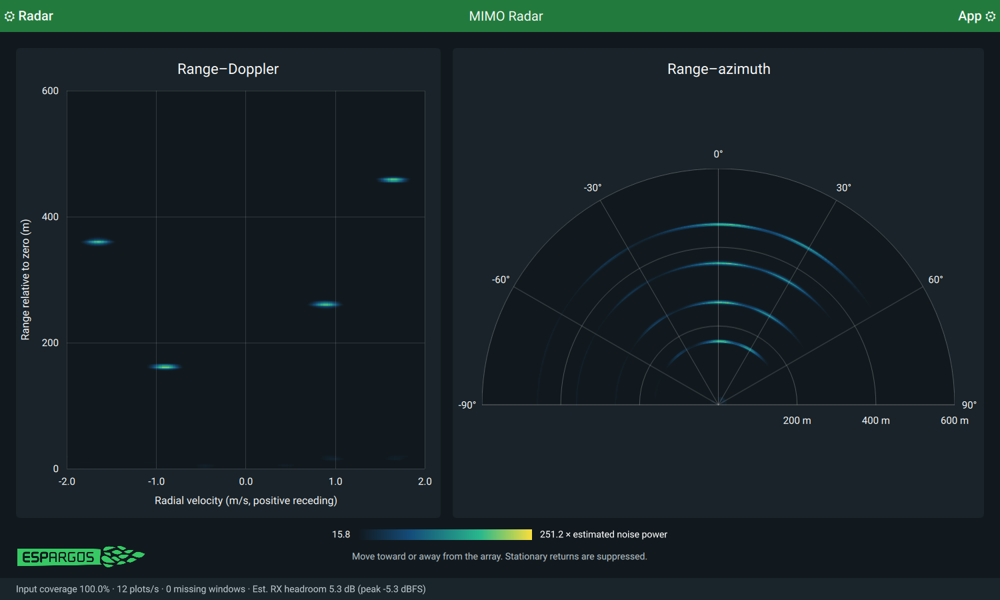

# Using the ESPARGOS MIMO radar demo

You can use the simulator with the MIMO radar demo in
[pyespargos](https://github.com/ESPARGOS/pyespargos) to see the
four echoes on a range–velocity plot. Run the following from the `pyespargos`
directory, replacing `ESPARGOS_ADDRESS` with your ESPARGOS address:

```sh
./demos/iq/mimo-radar/main.py -s ESPARGOS_ADDRESS \
  -o app.sample_rate=20 -o app.range_maximum=600
```

This selects a 20 MSa/s radar sample rate and a 600 m display range. Set both
the demo and Pluto to the same carrier frequency. Both default to 2385 MHz.
Add targets in the Pluto web interface, then adjust the demo's velocity window
to include them. The simulator starts with a 600 m range and ±3 m/s window.

Use the default gains as a starting point and adjust them for your antenna
placement. A stationary target may disappear because the demo suppresses
stationary reflections. Give it a nonzero velocity to make it visible. The demo's
repeating waveform limits unambiguous range to about 1.9 km at 20 MSa/s. Larger
ranges need a suitable radar waveform and processing window.



